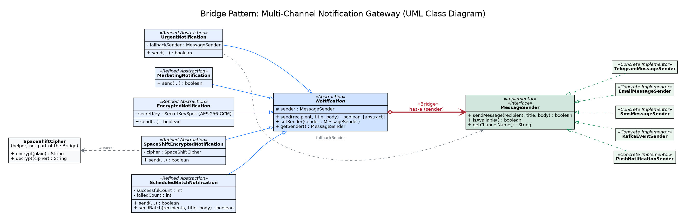

# Multi-Channel Notification Gateway (Bridge Pattern)

Assignment 3 for the *Software Design Patterns* course. Java 17, Maven, JUnit 5.

The gateway sends notifications of different **types** (urgent, marketing, encrypted, batch, ...) through different **delivery providers** (Telegram, Email, SMS, Kafka, Push). The two dimensions are connected with the **Bridge** pattern, so a new type or a new provider never forces changes in the other hierarchy.



The diagram source is in `docs/uml-class-diagram.dot` (Graphviz); `docs/uml-class-diagram.svg` is the same diagram as a vector image.

## Roles in the pattern

| Pattern role | Class |
|---|---|
| Abstraction | `Notification` (holds `protected MessageSender sender`) |
| Refined Abstractions | `UrgentNotification`, `MarketingNotification`, `EncryptedNotification`, `SpaceShiftEncryptedNotification`, `ScheduledBatchNotification` |
| Implementor | `MessageSender` (interface) |
| Concrete Implementors | `TelegramMessageSender`, `EmailMessageSender`, `SmsMessageSender`, `KafkaEventSender`, `PushNotificationSender` |
| The Bridge | the field `sender` in `Notification`, typed as the `MessageSender` interface |

## Answers to the assignment questions

**1. What are the two independent dimensions?**
The *notification type* (what is sent and how the message is prepared: add `[URGENT]`, add `[PROMO]`, encrypt, send to many recipients) and the *delivery provider* (where the message goes: Telegram, Email, SMS, Kafka, Push).

**2. Where exactly is the Bridge?**
In `Notification`: the field `protected MessageSender sender`. Every refined notification delivers messages only by calling `sender.isAvailable()` and `sender.sendMessage(...)` on the interface. No notification class names a concrete sender (they depend only on the `MessageSender` interface), and the sender classes do not import any notification class.

**3. Why is inheritance problematic here?**
With inheritance every (type, provider) pair needs its own class: `UrgentTelegramNotification`, `UrgentEmailNotification`, `EncryptedSmsNotification`, and so on. With 5 notification types and 5 providers that is 5 × 5 = 25 classes, and each new type or provider adds a whole row or column. With the Bridge it is 5 + 5 = 10 classes plus the two base types, and the combinations are chosen at runtime.

**4. What happens when a new provider is added?**
One new class implementing `MessageSender` is enough. No `Notification` class changes. `PushNotificationSender` is an example: it is used by all existing notification types without touching them. (The interactive menu in `Main` only needs one extra line so that the user can choose the new channel.)

**5. What happens when a new Notification type is added?**
One new subclass of `Notification` is enough. It uses the sender through the interface, so it works with every existing provider and no `MessageSender` implementation changes. `MarketingNotification` is an example: it works with all providers as is.

**6. Why is this Bridge and not Adapter?**
Adapter is applied after the fact to make an existing, incompatible interface fit the one a client expects. Here nothing is being adapted: `MessageSender` is our own interface, designed up front, and the goal is to let two hierarchies (what to send and where to send it) vary independently. That is the intent of Bridge. In an Adapter there is also no abstraction hierarchy of its own that grows next to the implementation hierarchy.

## Notification types

| Class | Behavior |
|---|---|
| `UrgentNotification` | Adds `[URGENT]` to the title, checks `isAvailable()`, and uses a fallback sender if the primary one is unavailable or fails. The fallback works through the `MessageSender` interface, with no `instanceof` checks. |
| `MarketingNotification` | Adds `[PROMO]` to the title. |
| `EncryptedNotification` | Encrypts title and body with AES-256-GCM (32-byte key, Base64 output) before sending. |
| `SpaceShiftEncryptedNotification` | Encrypts title and body with the own educational cipher (see below) before sending. |
| `ScheduledBatchNotification` | Sends one message to a list of recipients (`sendBatch`) and prints a summary (`Successful` / `Failed`). |

## Delivery providers

| Class | Behavior |
|---|---|
| `TelegramMessageSender` | Real call to the Telegram Bot API (HTML-escaped text). Needs `TELEGRAM_BOT_TOKEN`; the chat id comes from `TELEGRAM_CHAT_ID` in `Main`. |
| `EmailMessageSender` | Real SMTP delivery through Jakarta Mail. Available only when all `SMTP_*` variables are set. |
| `SmsMessageSender` | Simulated: appends the message (title and text) to `sms/<recipient>.txt`. Characters not allowed in Windows file names are replaced, so the file always stays inside `sms/`; an empty recipient is rejected. Maximum length is 160 characters (title + text), configurable through the constructor. |
| `KafkaEventSender` | Simulated: prints the event (topic = recipient, event = title, payload = body) to the console. |
| `PushNotificationSender` | Simulated: shows a Swing pop-up window. Needs a graphical environment; without one it returns `false`. |

## Runtime provider switching

The same `Notification` object can change its provider without any change in the notification class:

```java
Notification notification = new UrgentNotification(telegram, sms);

notification.send(user, "Title", "Message");   // via Telegram

notification.setSender(email);

notification.send(user, "Title", "Message");   // via Email
```

## Fallback

`UrgentNotification` takes a primary sender and a fallback sender. If the primary one is unavailable or `sendMessage` returns `false`, the message is sent through the fallback:

```java
Notification urgent = new UrgentNotification(telegram, sms);   // Telegram unavailable -> SMS
```

## Independent extension

* **New provider:** `PushNotificationSender` implements `MessageSender` and is used by every existing notification type unchanged.
* **New notification type:** `MarketingNotification` extends `Notification` and works with every existing sender unchanged.

This is the main advantage of the Bridge: the two hierarchies grow independently, adding a provider costs one class, adding a type costs one class, and neither change touches the other side.

## Own cipher (`SpaceShiftCipher`)

`SpaceShiftEncryptedNotification` uses an educational cipher designed for this project (package `com.example.notification.cipher`). It is **not real cryptography**; the assignment only requires a simple transformation, and `EncryptedNotification` is the AES-based variant.

* **Letters** (A-Z, case-insensitive): let `s` be the number of spaces in the message, `k = s` (or `5` if there are no spaces), `i` the letter index (A = 0). The letter becomes `round_half_up((i + k)^k / k)`, computed with `BigInteger`.
* **Numbers:** a run of digits is one number. It is written in binary, the first half (`length / 2`, rounded down) stays, the rest is reversed, and the result is written with the prefix `d` (for example `13` becomes `d1110`). Leading zeros are not preserved.
* **Format:** consecutive tokens are separated by `|`. Spaces and punctuation (printable ASCII except `|`) stay unchanged.
* **Decryption:** the receiver counts spaces (they are unchanged in the ciphertext), rebuilds the table of the 26 letter values and looks every token up. Number tokens are decoded with the same bit transformation, which is its own inverse.

Example: `Hello 2025` becomes `8|5|12|12|15 d11111100101`.

`com.example.notification.cipher.Decryptor` is a small console tool that decrypts a pasted message.

**Limitations:**
* The key (the number of spaces) is visible in the ciphertext, so anyone who knows the algorithm can decrypt the message.
* Case is not restored (decrypted letters are upper case) and leading zeros of numbers are lost.
* The characters `|`, line breaks, tabs and non-ASCII characters are not supported and are rejected.
* Ciphertext is much longer than the plain text, so encrypted messages often exceed the 160-character SMS limit.

## Configuration

Real providers read their settings from environment variables (never commit secrets):

| Variable | Used by |
|---|---|
| `TELEGRAM_BOT_TOKEN` | `TelegramMessageSender` |
| `TELEGRAM_CHAT_ID` | `Main` (recipient for Telegram) |
| `SMTP_HOST`, `SMTP_PORT`, `SMTP_USERNAME`, `SMTP_PASSWORD`, `SMTP_FROM` | `EmailMessageSender` |

Example for PowerShell (use your own values; open a new console afterwards):

```powershell
[Environment]::SetEnvironmentVariable("TELEGRAM_BOT_TOKEN", "<token>", "User")
[Environment]::SetEnvironmentVariable("TELEGRAM_CHAT_ID", "<chat id>", "User")
```

Email uses STARTTLS (port 587 in the usual case). For providers with two-factor protection an application password is required instead of the account password.

## Running

* Application: run `com.example.notification.Main` (for example from the IDE). Choose a channel, enter the recipient, title and message, then choose the notification type. Channels that need configuration report `Available: false` until the variables above are set.
* Tests: `mvn test`

## Tests

JUnit 5 tests are in `src/test/java`:

* `UrgentNotificationTest`: primary channel, fallback when the primary is unavailable, fallback when sending fails, both channels failing.
* `ScheduledBatchNotificationTest`: sending to all recipients, counting failures, empty list, blank recipients.
* `MarketingNotificationTest`: `[PROMO]` prefix, unavailable sender, failing sender.
* `EncryptedNotificationTest`: title and body are encrypted before sending, unavailable sender, invalid key length.
* `SmsMessageSenderTest`: availability, saving to a file named after the recipient, unsafe recipient names, empty recipient, the 160-character limit and a custom limit.
* `PushNotificationSenderTest`: availability, the message reaches the pop-up display, display failure.
* `KafkaEventSenderTest`: publishing an event, unavailable sender.